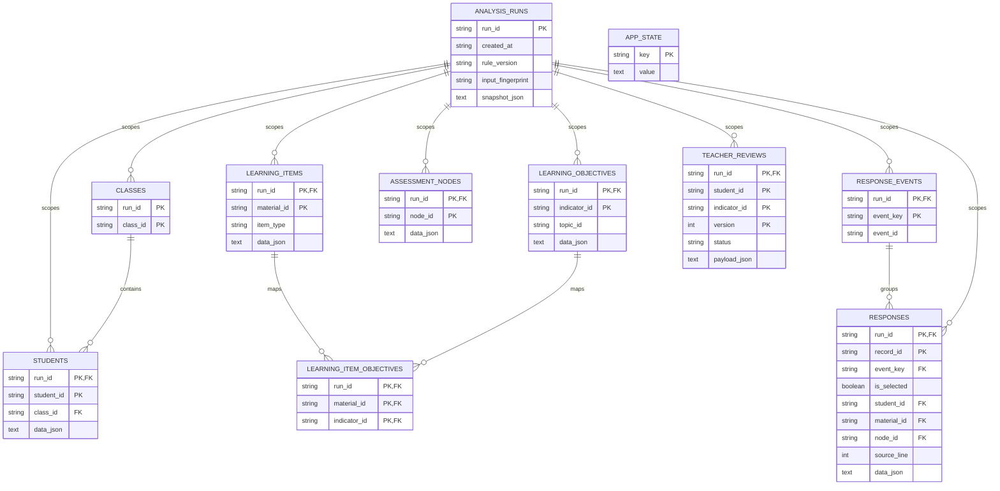

# 06 — SQLite 数据库设计

## 技术与生命周期

SQLite + SQLAlchemy 2.x + Alembic。Domain、ORM 和 Pydantic API schema 分离。数据库 URL 由 `SMART_LEARNING_DATABASE_URL` 配置，默认使用数据目录下 `smart_learning.db`；路径按 URL 编码规则传入，Windows 绝对路径示例：`sqlite:///D:/workspace/project/data/smart_learning.db`。没有环境变量时按 `SMART_LEARNING_DATA_DIR` 定位。

应用不自动建表或升级 schema。首次启动前在后端目录执行 `python -m app.cli db-upgrade`。SQLite 每个连接执行 `PRAGMA foreign_keys=ON` 和 `PRAGMA busy_timeout=5000`；本阶段未启用 WAL。开发及用户数据各自使用本地文件，不支持多用户高并发写入。

## ER 图

复合主键以 `(run_id, entity_id)` 隔离跨运行的相同赛事 ID。作答事件与原始作答分表；`responses.is_selected` 由当前分析结果投影，历史原始字段保存在 data_json。`learning_item_objectives` 支持多对多。对可能含无效上游引用的源作答，记录保留在快照和 responses，不强制学生/材料外键；有效核心实体和事件关系仍受约束。

`analysis_runs.snapshot_json` 保存原分析结果全文作为不可变兼容和恢复载体；学生、班级、目标、材料、节点、作答和复核仍有可查询关系表。尚未独立持久化的 Diagnosis/Evidence/Recommendation 不建空表，它们从分析快照和建议服务即时派生；教师实际复核保存在追加式 `teacher_reviews`。

## 事务及 Repository

`AnalysisRunRepository` 原子保存 run 元信息、规范化投影与当前指针；run ID 已存在且快照不同会拒绝覆盖。导入失败不会切换当前指针。`ReviewService` 先校验学生、目标和允许证据，Repository 再追加新版本。Repository 返回当前服务需要的 dict 兼容投影，不将 ORM 暴露给 API；业务统计仍由 TASK services 负责。

Repository 文件：`analysis_run_repository.py`、`review_repository.py`；`protocols.py` 声明读写边界，`Store` 装配 SQLAlchemy Database 与服务。schema 初始版本在 `apps/backend/alembic/versions/`。数据库约束、跨连接读写和事务失败用临时 SQLite 测试。
